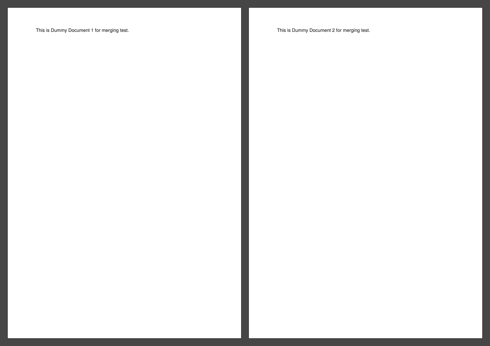
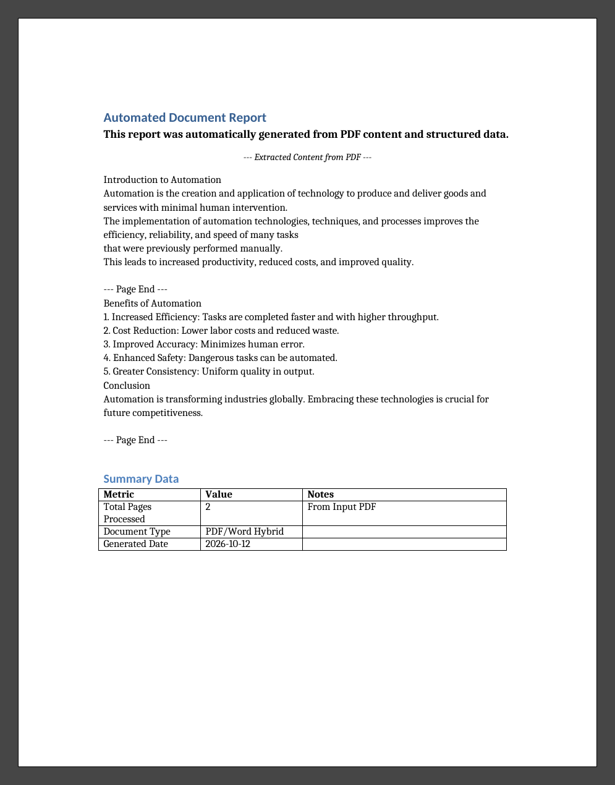

# Week 11: Automating PDFs & Word Documents

Automate common PDF and Word tasks in Python with `PyPDF2` and `python-docx`.

## Key Concepts Demonstrated
* **PDF text extraction** – read text from `input_article.pdf`
* **PDF merging** – combine `dummy_doc1.pdf` + `dummy_doc2.pdf` into `merged_output.pdf`
* **Word generation** – headings, formatted paragraphs and a table in `output_report.docx`
* **Modular design** – `pdf_processor.py`, `word_processor.py`, `utils.py`

## Setup & Run
```bash
python -m venv .venv
.venv\Scripts\activate        # Windows  (macOS/Linux: source .venv/bin/activate)
pip install PyPDF2 python-docx
python main.py
```

## Screenshots

### merged_output.pdf (2 pages: dummy_doc1 + dummy_doc2)


### output_report.docx


## Project Structure
```
document-automator/
├── src/
│   ├── __init__.py
│   ├── pdf_processor.py
│   ├── word_processor.py
│   └── utils.py
├── documents/
│   ├── input_article.pdf
│   ├── dummy_doc1.pdf
│   ├── dummy_doc2.pdf
│   ├── output_report.docx     # generated
│   └── merged_output.pdf      # generated
├── screenshots/
│   ├── merged_output.png
│   └── output_report.png
├── main.py
├── .gitignore
└── README.md
```
