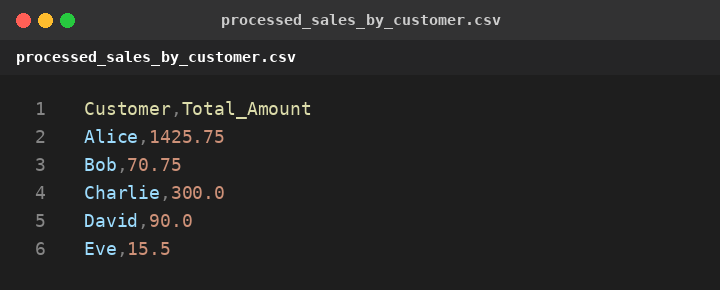
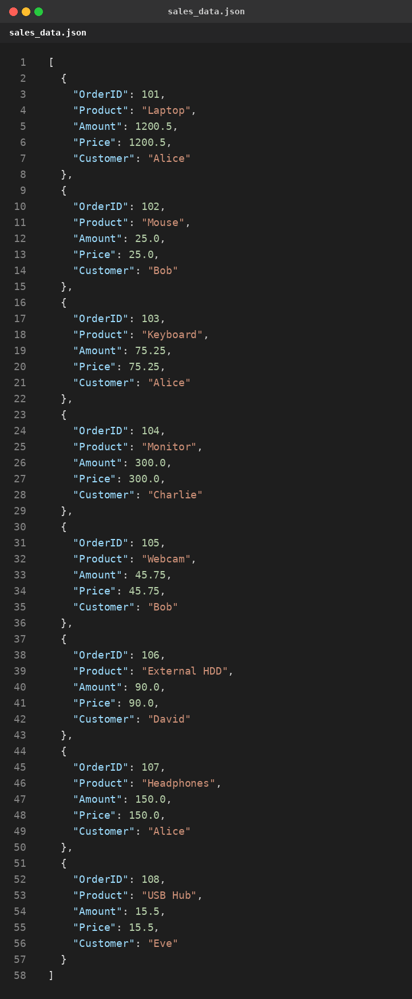
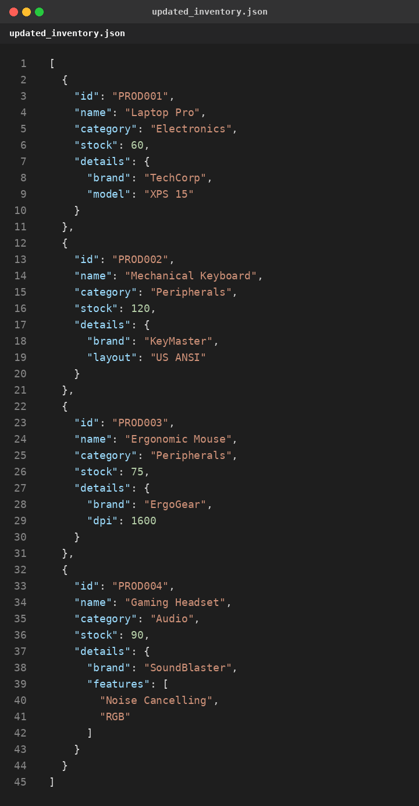

# Agentic Data Processor (Week 8 – Advanced)

Data Agent ที่ประมวลผล CSV / JSON ตามรายการ **tasks** ใน config (`configs/data_pipeline_config.json`)
โดยเก็บผลระหว่างทางใน `data_store` (ส่งต่อด้วย `input_data_key` / `output_data_key`) และบันทึก **audit report (JSON)** ทุกครั้งที่รัน

## Task types ที่รองรับ
`load_csv`, `save_csv`, `filter_csv`, `transform_csv_aggregate`, `load_json`, `save_json`,
`update_json_data` (set / add_to_list / remove_from_list), `query_json_data`,
`csv_to_json_conversion`, `json_to_csv_conversion`

## Pipeline ใน config
1. โหลด `input_sales.csv` → กรอง Amount ≥ 100 → รวมยอดขายต่อลูกค้า → **`processed_sales_by_customer.csv`**
2. แปลง CSV เป็น JSON (แปลงตัวเลขอัตโนมัติ) → **`sales_data.json`**
3. โหลด `input_inventory.json` → query ชื่อสินค้าแรก → อัปเดต stock (PROD001=60, PROD003=75) + เพิ่ม PROD004 → **`updated_inventory.json`**

## Run
```bash
cd week8/agentic-data-processor
python main.py
```

## Output Evidence (Screenshots)

### `data/processed_sales_by_customer.csv`


### `data/sales_data.json`


### `data/updated_inventory.json`


## Structure
```
agentic-data-processor/
├── configs/data_pipeline_config.json
├── data/
│   ├── input_sales.csv
│   ├── input_inventory.json
│   ├── processed_sales_by_customer.csv
│   ├── sales_data.json
│   └── updated_inventory.json
├── reports/audit_report_<timestamp>.json
├── screenshots/
│   ├── processed_sales_by_customer.png
│   ├── sales_data.png
│   └── updated_inventory.png
├── src/
│   ├── __init__.py
│   ├── config_parser.py
│   ├── conversion_tasks.py
│   ├── csv_tasks.py
│   ├── data_agent.py
│   ├── json_tasks.py
│   └── utils.py
├── main.py
├── AllCode.md
├── .gitignore
└── README.md
```
