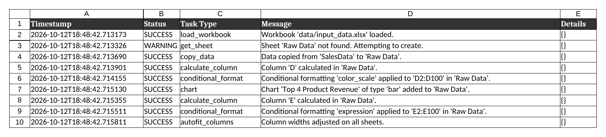
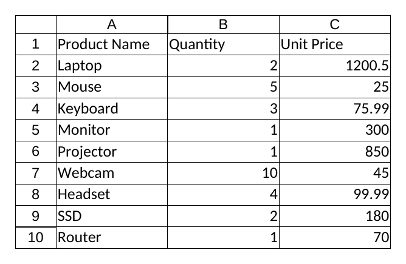
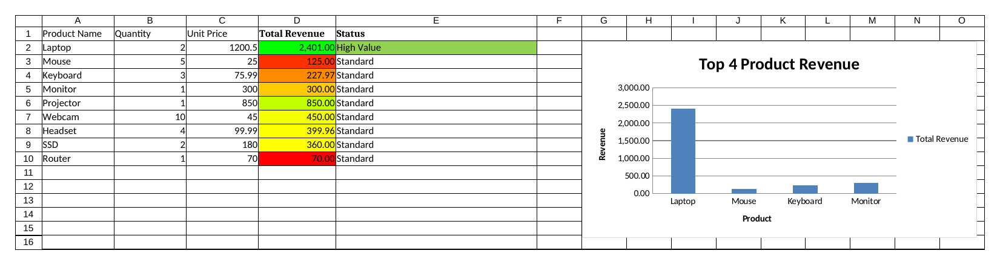

# Week 10 (Advanced): Advanced Spreadsheet Automation & Agentic Workflows

An "Agentic Spreadsheet Processor": a Python agent that reads a JSON config, then executes a list of tasks
on an Excel workbook with `openpyxl` (copy data, formulas, conditional formatting, charts) and records
everything in an **Audit Log** sheet.

## Setup & How to Run

```bash
python -m venv venv
venv\Scripts\activate          # Windows (macOS/Linux: source venv/bin/activate)
pip install -r requirements.txt
python create_dummy_data.py    # creates data/input_data.xlsx (sheet: SalesData)
python main.py                 # creates data/output_report.xlsx
```

## Output Screenshots (`data/output_report.xlsx`)

**Sheet: Audit Log**



**Sheet: SalesData**



**Sheet: Raw Data** (Total Revenue, color scale, Status highlight, bar chart)



## Project Structure

```
agentic-spreadsheet-processor/
├── configs/
│   └── example_spreadsheet_config.json
├── data/
│   ├── input_data.xlsx
│   └── output_report.xlsx
├── screenshots/
├── src/
│   ├── __init__.py
│   ├── config_parser.py
│   ├── google_sheets_utils.py   # placeholder
│   ├── spreadsheet_agent.py
│   └── utils.py
├── create_dummy_data.py
├── main.py
├── requirements.txt
├── .gitignore
└── README.md
```

## Task types (in the JSON config)

`copy_data`, `calculate_column`, `conditional_format` (color_scale, data_bar, icon_set, expression), `chart` (bar, line, pie).

## Debugging

* `KeyError: 'SheetName'`: sheet names in the config must match the workbook exactly.
* `#NAME?` / `#VALUE!`: check the formula string in the config.
* Chart labels shifted: `data_range` includes the header row (series title), so `category_range` must start one row lower (`A2:A5`).
* Check the console and the **Audit Log** sheet to see which task failed.

## Extension Ideas

Google Sheets (`gspread`), SQLite/API data sources, data validation and sheet protection tasks, CLI arguments, task dependencies.

## Ethical Notes

Only process spreadsheets you are authorised to use, keep credentials (e.g. Google keys) out of the repository,
and review automated output before relying on it.
