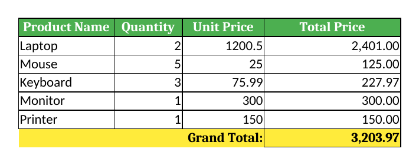

# Week 10: Automating Spreadsheets (Excel & Google Sheets)

This project uses Python's `openpyxl` library to read sales data from an Excel
file, calculate totals, and write a formatted report to a new Excel file.

## Key Concepts Demonstrated

* **`openpyxl`**: reading, writing and modifying `.xlsx` files
* **Workbook & Worksheet management**: load, create, name and save sheets
* **Cell manipulation**: reading/writing values by row and column
* **Data processing**: iterating rows, skipping empty rows, calculating totals
* **Basic formatting**: fonts, fills, borders, number formats, merged cells
* **Column width adjustment** for readability

## Setup & How to Run

```bash
git clone https://github.com/YOUR_USERNAME/spreadsheet-automator.git
cd spreadsheet-automator
python -m venv venv
venv\Scripts\activate        # Windows  (macOS/Linux: source venv/bin/activate)
pip install openpyxl
python main.py
```

The script loads `data/input_sales.xlsx`, calculates the total price per item
and a grand total, then writes `data/output_sales_report.xlsx`.

**Input (`data/input_sales.xlsx`)** - includes one empty row to show it is skipped:

| Product Name | Quantity | Unit Price |
| :----------- | :------- | :--------- |
| Laptop       | 2        | 1200.50    |
| Mouse        | 5        | 25.00      |
| Keyboard     | 3        | 75.99      |
| Monitor      | 1        | 300.00     |
| *(empty)*    |          |            |
| Printer      | 1        | 150.00     |

## Output Screenshot



## Project Structure

```
spreadsheet-automator/
├── src/
│   ├── __init__.py
│   └── excel_processor.py   # Core Excel logic
├── data/
│   ├── input_sales.xlsx
│   └── output_sales_report.xlsx
├── screenshots/
├── main.py                  # Entry point
├── .gitignore
└── README.md
```

## Debugging Spreadsheet Automation

* **`FileNotFoundError`**: make sure `input_sales.xlsx` is inside `data/`.
* **`InvalidFileException`**: the file is corrupted or not a real `.xlsx` (old `.xls` is not supported).
* **`IndexError` / `TypeError`**: text where a number is expected; the script wraps conversions in `try-except`.
* **Data mismatches**: column order must be Product Name, Quantity, Unit Price.
* **Formatting not showing**: apply styles to the cell objects before saving.

## Extension Ideas

Google Sheets (`gspread`), data validation, charts, conditional formatting, a GUI, database integration.

## Ethical Notes

Only process spreadsheets you are authorised to use, avoid committing files with personal or confidential
data, and keep API credentials (e.g. Google OAuth keys) out of the repository.
