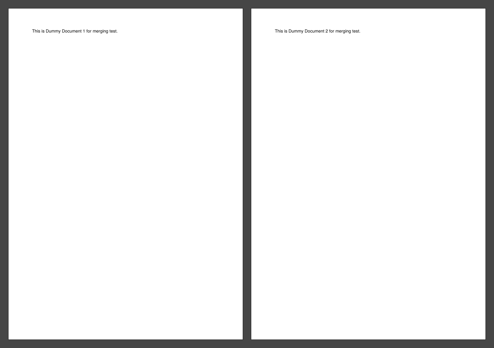
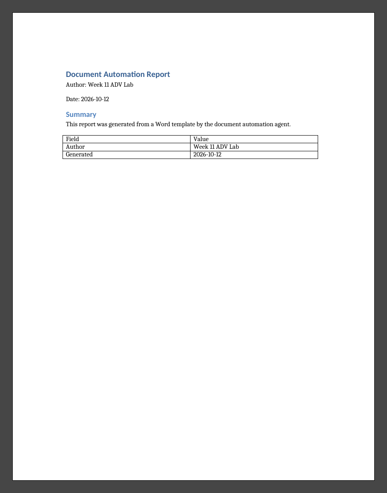
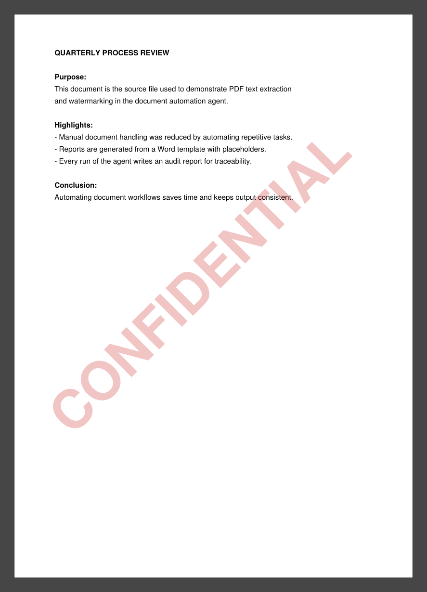

# Week 11 (ADV): Document Automation Agent

An agent that reads a JSON config and runs PDF / Word tasks: text extraction, merging, watermarking and template-based report generation. Every run writes an audit report to `documents/reports/`.

## Setup & Run
```bash
python -m venv .venv
.venv\Scripts\activate        # Windows  (macOS/Linux: source .venv/bin/activate)
pip install -r requirements.txt
python make_samples.py        # creates sample PDFs + Word template (first time only)
python main.py
```

## Screenshots

### merged_docs.pdf (dummy_doc1 + dummy_doc2)


### generated_report.docx (filled from templates/report_template.docx)


### watermarked_document.pdf (watermark: CONFIDENTIAL)


## Project Structure
```
document-agent/
├── configs/document_automation_config.json
├── documents/        # inputs + generated outputs
│   └── reports/      # audit_report_<timestamp>.txt
├── screenshots/
├── src/              # config_parser, document_agent, pdf_tasks, word_tasks, utils
├── templates/report_template.docx
├── main.py
├── make_samples.py
├── requirements.txt
└── README.md
```
